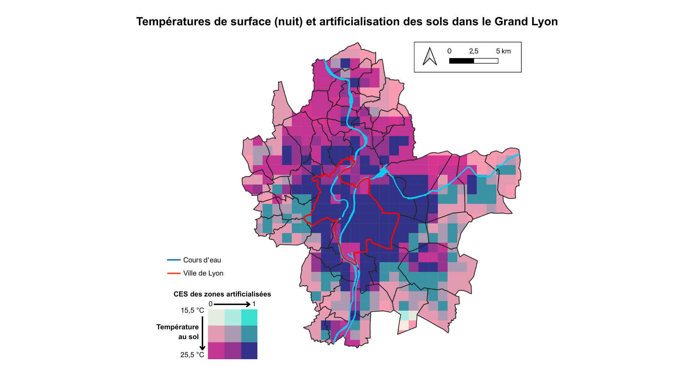
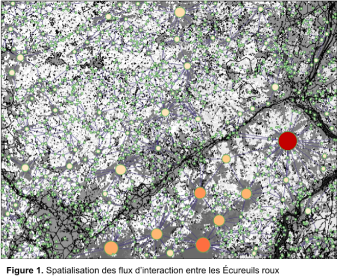

On this page, a portfolio of some GIS projects achieved over the last two years, over the course of my Masters and my internship.

## Selected projects

The projects presented here are mostly excerpts of larger tasks. The aim of this portfolio is to briefly exhibit GIS skills rather than present exhaustive scientific works.
Even though I described each project in English, the layout of many maps is still in French, langage in which they were first realized. This was deemed to be of a minimal impact on the understanding of the different projects achieved.

---

<h3> 1. Spatial analysis of urban heat islands: a case study of the Greater Lyon </h3>

<h3> 2. Ecological connectivity and wildlife corridors: potential ecological impacts of the A45 highway between Lyon and Saint-Étienne </h3>

<h3> 3. Beech distribution in the Pyrenees: multicriteria analysis and weighted score matrix </h3>

