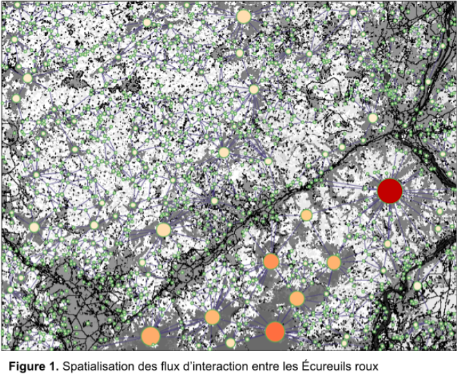
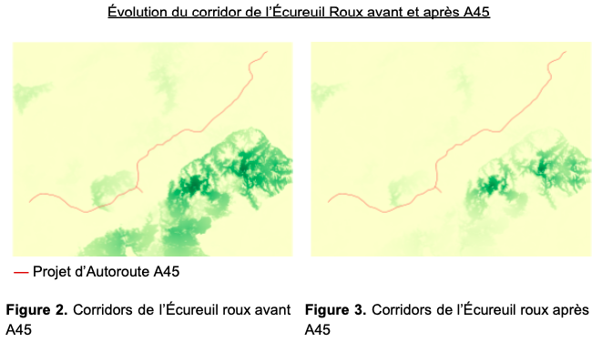

# Ecological connectivity and wildlife corridors : potential ecological impacts of the A45 highway between Lyon and Saint-Étienne

The making of highways has a proven ecological impact, cutting through lands and reducing the range of wildlife mobilities. Modelisation of current ecological connectivity can be an asset in order to plan and minimize the impacts of a potential highway. In this project, I used the specialized software Graphab in order to simulate the mobilities of different species, with and without the presence of a highway. Presented here is the case study for the red squirrel.

Down below is a map of the main mobilities of red squirrels realized on Graphab, over the planned construction site of the A45 highway. To simulate the mobilities, I searched for data on "travel costs" in the scientific literature, with which I calibrated each animal's mobilities (Bourgeois, 2015).

With the data transferred and analyzed on QGIS, it is possible to visualize, according to a gradient of green, the places where the red squirrel can move around in, with and without the existence of a highway.

The existence of a highway would disturb the ecological connectivity of this specific species, as show the maps. The study has then given place to statistical analyses, evaluating the loss of connectivity at -1,79%. For other species, this number can be higher : -7,41% for the viviparous lizard, for instance. Each of the present species may be simulated likewise, and then the maps interpolated. Such studies can help decision making by setting geographical criteria for minimal ecological impact.

Data : Bourgeois (2015), Institut Géographique National

## Cited literature :
- Bourgeois, M., "Impacts écologiques des formes d'urbanisation : modélisations urbaines et paysagères. Géographie", Université de Franche-Comté, 2015.
