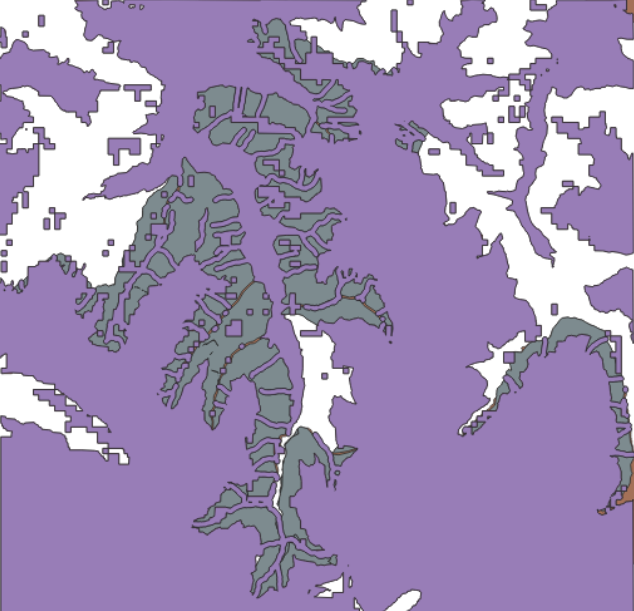
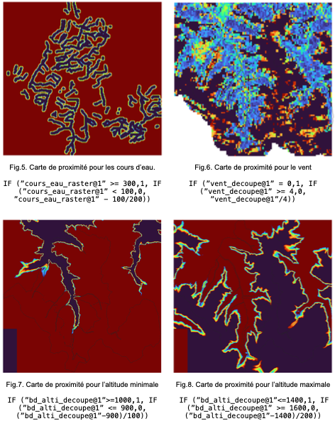
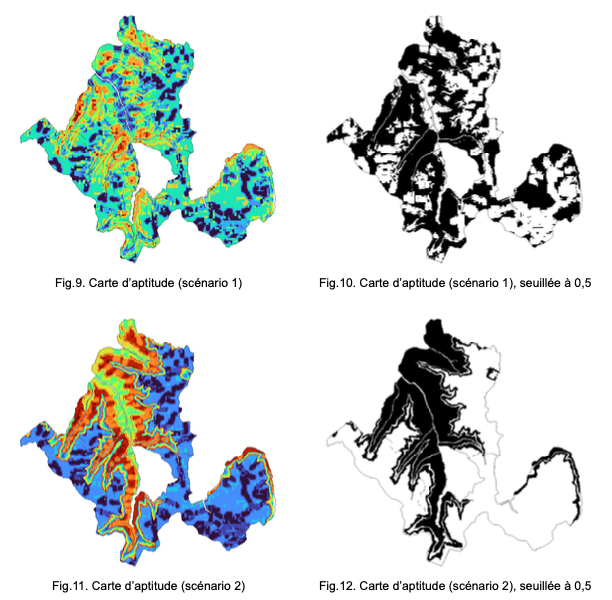

# Beech distribution in the Pyrenees : multicriteria analysis and weighted score matrix

Multicriteria analysis and weighted score matrix are often used in the context of environmental impact studies. In this project, I wanted to apply the same methods to think about the distribution of beech in the National Park of the Pyrenees. The aim of this project was then to think about the evolution of beech distribution in regards to climate variability (Landmann, G. et al, 2007)

In order to achieve this project, I searched for different criteria allowing or preventing the presence of beech trees (Gruber, 1980; Forêt.Nature, foretnature.be). Once those criteria established and spatialized, I came to a first map of exclusion zones, where beech could not grow. 

A raster image of the "proximity" to each criteria was then produced, where the best zones, according to each criteria, were given a score of 1, and as we got further, the score lowered proportionally until it reached 0. 

Interpolated with a weighted score matrix, these rasters finally gave me a raster of the sector, where pixels were coloured according to their aptness to grow beech trees.

Data : Global wind atlas, Institut Géographique National, Météo France (Drias)

## Cited literature
- « Fiche écologique du hêtre », Fichier écologique des essences; www.fichierecologique.be.
- Gruber, M., « Le Hêtre et le Sapin dans la chaîne pyrénéenne », Revue forestière française, 32, 1980.
- Landmann, G., Dupouey, J.-L., Badeau, V., Lefevre, Y., Bréda, N., et al., « Le hêtre face aux changements climatiques », Rendez-vous Techniques de l’ONF, hors-série 2, 2007.

