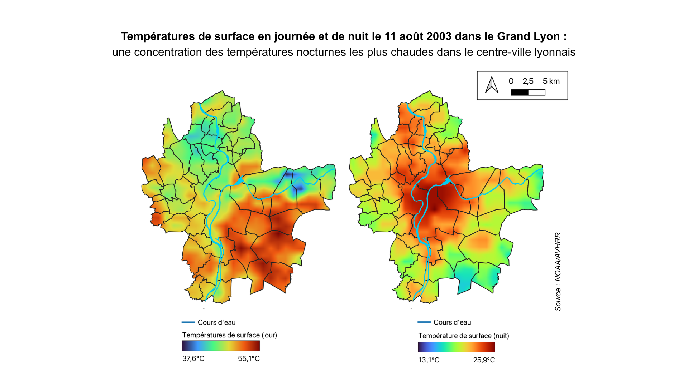
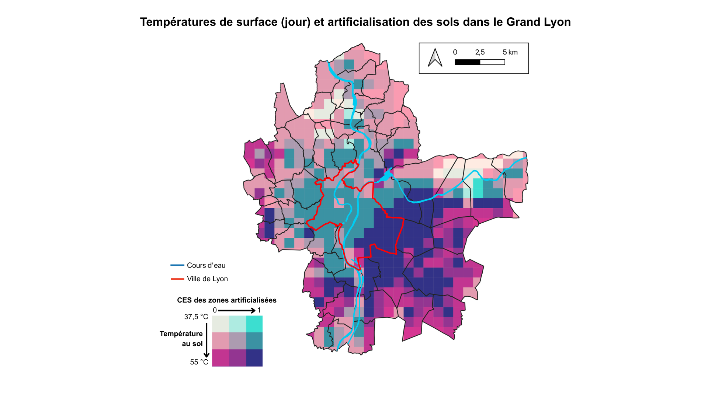
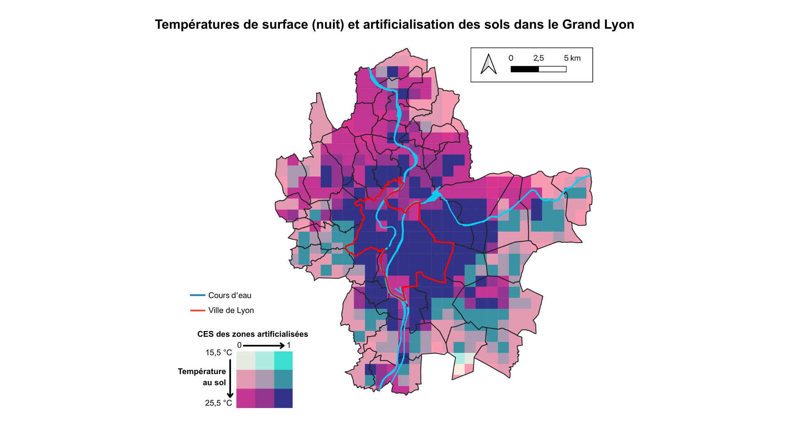

# Spatial analysis of urban heat islands : a case study of the Greater Lyon

In order to understand the urban heat island phenomenon In the Greater Lyon over the course of the major 2003 heat wave, bivariate maps allow us to link spatially two quantitative variables : here, we look at the correlation between surface temperature (day and night) and the density of artificial lands.

The bivariate maps shown below indicate a potential correlation between the density of artificial lands and the nightly heat, possibly due to heat trapping. Those observations are supported by scientific papers studying the link between night time urban heat and city density (Li et al., 2020; Schrijvers et al., 2015).

From raster images of the temperature (resolution of 1 km), I created three different classes of heat intensity, using the raster calculator. To evaluate the density of artificial lands, using the Corine Land Cover land use vectors, I calculated the surface ratio of artificial lands per 1x1km pixel (according to the resolution of the raster images). In the same manner, those density were then translated into three different classes. Those classes were then visualized together in order to create the two bivariate maps.

## Data
Institut Géographique National, Corine Land Cover, NOA-AVHRR imagery

## Cited literature
- Li, Y., Schubert, S., Kropp, J.P. et al., “On the influence of density and morphology on the Urban Heat Island intensity”, Nat Commun, 11, 2020.
- P.J.C. Schrijvers, H.J.J. Jonker, S. Kenjereš, S.R. de Roode, “Breakdown of the night time urban heat island energy budget”, Building and Environment, 83, 2015
